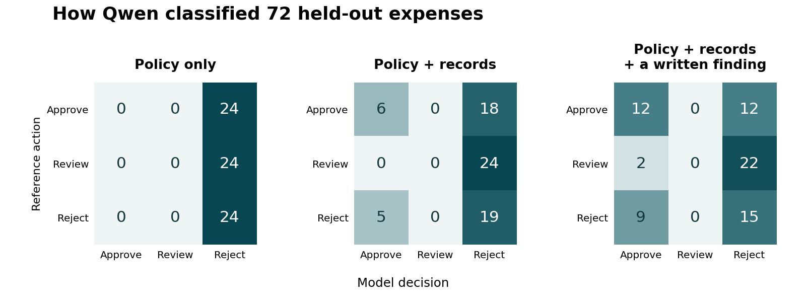

# Expense Policy Benchmark

When can an expense reviewer safely hand an approval to a model? This benchmark compares decisions on matched claims: the policy and transaction stay fixed while one supporting fact changes. A later approval timestamp, an unsettled reimbursement, or a missing exchange rate can change the correct action from approve to review or reject.

The project is independent portfolio research inspired by Ramp's public discussion of disagreement and escalation in expense review. All policies, transactions and labels are synthetic. [Ramp's financial benchmarks](https://builders.ramp.com/post/financial-benchmarks)

## Learn to inspect expense records

In the interactive environment, an agent starts with a claim and two ordered policy checks. It chooses which of four evidence sources to open, pays a cost for each lookup, and submits an approval, rejection or referral with citations. The original benchmark grader supplies the terminal reward. [Environment](src/expensebench/interactive_env.py) · [REINFORCE implementation](src/expensebench/interactive_agent.py)

We trained five 102-parameter policies from random initialization. On **288 fresh cases from six unseen policy families**, mean decision accuracy rose from **33.3% to 100%**. Exact decision **and** citations rose from **0% to 100%**. Every final policy matched the hand-coded rule executor. The agent reads typed policy checks and learns when to inspect, stop and decide. The language-model experiment below evaluates written policy separately. [RL results and limitations](reports/interactive-rl.md) · [Held-out scores](results/interactive/test_summary.json) · [Dataset](data/interactive/README.md)

To watch an agent review a claim before and after training, run these commands from a clone:

```bash
python -m pip install -e .
python examples/review_one.py C-0345ad79737e --seed 11
```

To train another agent with an RL library, install `python -m pip install -e '.[gym]'`. The [Gymnasium interface](src/expensebench/gym_env.py) exposes the same seven actions, lookup costs and terminal grader.

## Evaluate a language model on written expense policy

**The benchmark selected human approval for every claim.** On 72 held-out claims, Qwen with the supporting records proposed 11 approvals, five of them incorrect. Asking for a written finding produced 23 approvals, 11 incorrect. In one duplicate-payment case the model correctly identified a matching receipt and a settled prior payment, then approved the claim again. [Results and failure analysis](reports/results.md) · [Per-case decisions](results/heldout_decisions.jsonl)



One development pair uses the same $150 course invoice, dated July 14, for a course starting July 16. In case `C-8019e2393`, the registrar confirmed enrollment on July 15, so the policy says to approve. In `C-c121eeaaf`, that one date moves to July 18 and the correct action becomes reject. The receipt alone cannot distinguish them.

### Language-model comparison

- **120 cases in 60 matched pairs.** Four policy families are used for development and six different families for the final test. Each family has four cases for each of the three actions.
- **One model, three conditions.** Qwen2.5-7B-Instruct sees the expense and policy, then the same inputs with records from SQLite, or the full records with a request for one factual finding. A fixed receipt rule, an always-review baseline and a citation check put those results in operational terms.
- **A frozen routing decision.** Among the five originally eligible methods, select the one that approves the most development claims with zero observed false approvals. Refer every other claim to a person. The secondary factual-finding condition tests a prompt change on identical information.
- **Inspectable grading.** Scores cover three-way decisions, both members of each pair, false approvals and cited records. Each response can be traced to its original model output and exact request digest.

## Reproduce

```bash
python -m pip install -e '.[test]'
python -m pytest -q
python -m expensebench.experiment report --out .cache/replay
```

The published outputs can be rescored on CPU without model access. The [reproduction guide](reports/reproduction.md) includes instructions for testing a new reviewer and measuring independent human agreement. The [dataset card](data/README.md) describes the policy families and label construction. The [experiment protocol](protocol/experiment.md) records the decision rule.
