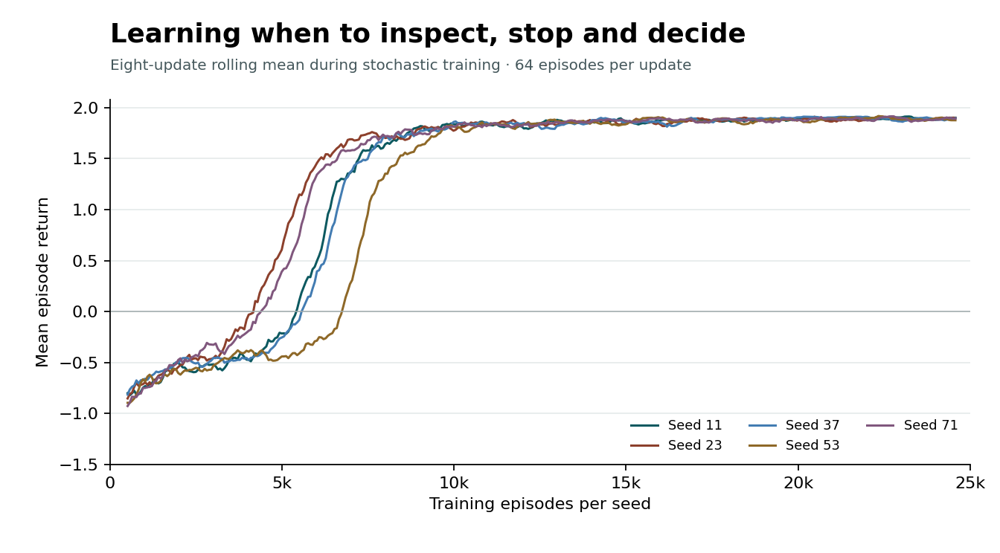

# Learning which expense records to inspect

**All five trained policies learned to take the same evidence-efficient path as a hand-coded policy executor.** Across 288 held-out claims, the average untrained policy got one-third of decisions correct. After reinforcement learning, each policy got all 288 decisions correct, cited the exact required records, and stopped after one or two lookups. The policies were trained on a machine-readable expense workflow. The result demonstrates transfer to new policies written in that same rule language.

## What changed with training

| Policy | Decision accuracy | Correct decision and exact citations | Both arms of pair correct | Mean lookups | Mean episode return |
| --- | ---: | ---: | ---: | ---: | ---: |
| Always request human review | 33.3% | 0% | 0% | 0.00 | −0.500 |
| Before REINFORCE, five-seed mean | 33.3% | 0% | 3.3% | 1.45 | −0.706 |
| After REINFORCE, five-seed mean | 100% | 100% | 100% | 1.67 | +1.917 |
| Execute the public rules directly | 100% | 100% | 100% | 1.67 | +1.917 |

There are 288 distinct cases and 144 matched pairs. Every seed saw the same held-out cases before and after training. Before training, the individual seeds got 144, 48, 96, 96 and 96 decisions right. None earned a fully correct decision with exact citations. After training, each seed approved the 96 eligible cases, rejected 96 known violations and referred 96 cases with missing evidence. There were zero false approvals per seed. The untrained policies produced 96 false approvals in total, all from seed 23. The always-review baseline issued no approvals.

The paired increase in mean return was +2.623. Resampling the six held-out policy families 10,000 times gave a descriptive 95% interval of +2.622 to +2.623. The action-accuracy gain was identical in every family (+66.7 percentage points pooled across seeds), so its family-bootstrap interval collapses to that value. The artificial balance and common decision structure explain why this interval conveys little about performance on a new type of workflow. [Per-family, per-seed and paired statistics](../results/interactive/test_summary.json)

## One claim before and after

An employer reimburses an emergency generator hire for up to 24 metered hours. In case `C-0345ad79737e`, seed 11 initially opened the ledger (24 hours), then the registry (office region) and the document system (invoice format). It rejected the claim without checking whether the dispatch was an emergency. Three lookup costs and the wrong disposition produced a return of −1.15.

After training, the same seed opened **authorization** first. It found an emergency dispatch, opened the **ledger** for the meter reading, approved at the inclusive 24-hour limit, and cited the policy and both records. Its return was +1.90. In the matched claim `C-f8ccb6dfcf5d`, the meter reading was missing. Following the same two lookups, the agent referred the claim and again earned +1.90. On cases where the first check already determined the outcome, the trained agent stopped after one lookup.

```bash
python examples/review_one.py C-0345ad79737e --seed 11
python examples/review_one.py C-f8ccb6dfcf5d --seed 11
```

## Environment, grader and policy

An episode starts with an expense, the policy prose, two ordered typed predicates, four tool names and no supporting records. A lookup reveals one case-local record. The agent can open at most three of the four sources: registry, ledger, document or authorization. The first violated check requires rejection, the first missing value requires human review, and approval follows two successful checks. [Environment](../src/expensebench/interactive_env.py) · [Dataset card](../data/interactive/README.md)

| Event | Reward |
| --- | ---: |
| Open a new source | −0.05 |
| Correct disposition with the exact required citations | +2.00 |
| Correct disposition with imperfect citations | +0.50 |
| Incorrect review or rejection | −1.00 |
| False approval or invalid interaction | −3.00 |

The existing action-and-evidence grader evaluates the terminal submission. Repeated or over-budget lookups and attempts to cite unseen records end the episode as invalid. The trained agent automatically cites the policy and every inspected record. An unnecessary lookup therefore costs time and can lose exact-citation credit. Evidence selection is learned through tool use. [Original grader](../src/expensebench/scoring.py)

The optional [Gymnasium interface](../src/expensebench/gym_env.py) exposes the same task to other RL algorithms. The observation gives the source and current status of each check, the sources already inspected and the remaining lookup budget. The action mask identifies legal moves. Install `python -m pip install -e '.[gym]'`, then run the following in Python to inspect the source named by the first check.

```python
from expensebench.gym_env import GymExpenseEnv

env = GymExpenseEnv(split="dev", include_raw=True)
obs, info = env.reset(seed=11)
first_source = int(obs["check_sources"][0])
obs, reward, terminated, truncated, info = env.step(first_source)
print(reward, info["raw_observation"]["records"])
```

The actor has 102 trainable logits and biases. The observation encoder marks each of two predicates unread, missing, satisfied or violated using the published comparator and any retrieved value. The actor learns a distribution over opening the first named source, opening the second, opening another source, or submitting one of the three dispositions. No reference decision or required citation set enters the actor or optimizer. Arithmetic, identifying which tool a predicate names, and rendering citation IDs are engineered. The actor does not parse the policy prose. [Actor and gradient update](../src/expensebench/interactive_agent.py)

## Experiment design

The interactive dataset adds 1,536 training cases from eight families, 144 development cases from three different families, and 288 test cases from six more. Each matched pair changes a single evidence value. Held-out families, policy texts and case IDs are distinct from training and development. The six test families are new to this release. [Data generator](../data/interactive/generate.py)

Five on-policy REINFORCE runs each collected 24,576 training episodes (122,880 total). The optimizer used discounted return-to-go with discount 1, a running baseline per observed state, entropy regularization and Adam. For each seed, evaluation used the initialized actor and the final actor after 384 updates, with greedy action selection at both checkpoints. No seed or checkpoint was selected on held-out results. The experiment plan was committed first. The task definition, fixture hashes and ten checkpoints were then frozen and pushed before test inference. [Protocol](../protocol/interactive-rl.md) · [Pre-evaluation freeze commit](https://github.com/Waknis/expense-policy-benchmark/commit/bb8137ec9f74b8e67402cd037d96d9061c8c6d71) · [Hash manifest](../results/interactive/freeze.json)



## What the benchmark supports

For policies already encoded as these two typed checks, the deterministic executor is the simpler deployment choice. It matched every final policy with the same evidence cost and needed no training. The RL result shows that scalar feedback can teach an agent the inspection and stopping strategy. The experiment covers three predicate operators, four tools and at most three lookups. Open-ended document interpretation, long workflows and customer expense distributions require different evaluations. The labels were generated from synthetic policies, without independent finance-expert adjudication. The earlier Qwen results concern a separate agent, task and holdout.

## Reproduce from a clone

Python 3.11+ and a CPU are sufficient. Run from the repository root. The commands write fresh training and evaluation artifacts under `.cache/`.

```bash
python -m pip install -e '.[test,gym]'
python -m pytest -q
python reports/verify_interactive_lock.py
python -m expensebench.interactive_train train --output-dir .cache/rl/training
python -m expensebench.interactive_train replay --split test --models .cache/rl/training --output .cache/rl/test.jsonl
python -m expensebench.interactive_report --split test --rollouts .cache/rl/test.jsonl --out .cache/rl/summary.json
```

To replay the archived checkpoints directly, omit `--models` from the replay command. The report re-executes every simulated interaction and verifies the returned record, action reward, cumulative reward, final submission and grader output. It also runs both reference strategies against the same simulator. The full training logs, checkpoints and evaluation trajectories are public. [Training artifacts](../results/interactive/training) · [Evaluation trajectories](../results/interactive/rollouts) · [Replay and analysis](../src/expensebench/interactive_report.py)
