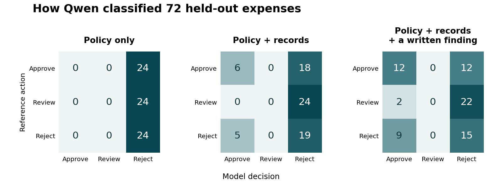

# Expense approvals under six unseen policy families

**Keep a human in the approval loop for every claim in this experiment.** The model with access to the supporting records approved 11 of 72 held-out claims. Five were explicit policy violations. Asking the same model to state a factual finding increased approvals to 23 and incorrect approvals to 11.

## How the decision was made

Each case has a written policy, an expense, supporting records and a reference action. A matched pair changes one evidence value and flips the required action. Development used 48 cases from four policy families. Test used 72 different cases from six other families. Each test action occurs 24 times. The local Q4_K_M model, Qwen2.5-7B-Instruct, produced 360 completions across the two splits and three conditions.

The protocol chose the highest development approval coverage among eligible methods with zero observed false approvals. The receipt rule produced nine false approvals out of 12 proposals. The model with records produced two out of seven. The citation gate stopped all seven of its proposals. None of the eligible methods could approve a development claim while satisfying the error requirement, so the predeclared fallback sent everything to a reviewer. This decision was committed before test inference. A model rejection would also go to a human. [Protocol](../protocol/experiment.md) · [Frozen selection](../results/development_selection.json)

## Held-out results

| Method | Correct actions / 72 | Both cases correct / 36 pairs | Approved / 72 | False / approved |
| --- | ---: | ---: | ---: | ---: |
| Always refer to reviewer | 24 | 0 | 0 | — |
| USD 75 receipt rule | 24 | 0 | 4 | 3 / 4 |
| Qwen, policy and expense only | 24 | 0 | 0 | — |
| Qwen, policy and records | 25 | 0 | 11 | 5 / 11 |
| Same decisions with citation gate | 19 | 0 | 0 | — |
| Qwen, records and a written finding | 27 | 3 | 23 | 11 / 23 |

A false approval is an approved case whose reference is review or reject. The rate is undefined when a method approves nothing. All 216 held-out model responses parsed successfully. Across the three conditions the model never selected review, including on the 24 claims where the policy required it. In the policy-only condition both members of every pair have identical visible inputs. The model rejected all 72.

We checked whether the output format could be suppressing the review action. After the benchmark, the same server returned the requested action in six explicit controls covering all three actions and both JSON formats. Its rendered chat template contained the full system instructions and case input. The controls are published separately. [Format and template probes](../results/format_probe.json)

**Adding records improved accuracy by one case**, from 24/72 to 25/72. The paired difference was +1.4 percentage points, with a 95% family-bootstrap interval of −2.8 to +5.6 points. The direct model changed its answer on five of the 36 pairs and got both arms right on zero.

**Asking for a finding improved accuracy by two further cases**, from 25/72 to 27/72. The difference was +2.8 points (95% interval −6.9 to +11.1). That variant changed its answer on 15 pairs and solved three completely. It used 4,831 completion tokens versus 2,713 for direct decisions, a 78% increase. The finding variant was a separate same-information comparison and was ineligible for route selection. [Secondary protocol](../protocol/secondary-comparison.md) · [Per-family counts and intervals](../results/heldout.json)

The intervals use 10,000 paired resamples of whole policy families. Each draw preserves the two arms and all competing methods' answers. Six hand-built families give limited information about how results might change on different policies. The constructed label balance also differs from an expense queue in production.

## Two decisions worth reading

**A correct observation led to a duplicate payment recommendation.** A $62 cab claim matched receipt R-665 in an earlier settled payment. Both full-evidence variants approved it. The finding correctly identified the match and settlement. In its twin, the earlier receipt reference is missing, so the policy requires human review. Both variants rejected it. The two model outputs demonstrate separate failures in mapping known facts to a decision and handling missing evidence. [Matched receipt response](../results/predictions/llm_finding.jsonl#L64) · [Missing reference response](../results/predictions/llm_finding.jsonl#L52)

**Four minutes changed the correct answer.** A $151 equipment charge required approval strictly before 16:30 UTC. With authorization at 16:26, both full-evidence variants rejected an eligible claim. When the authorization moved to exactly 16:30, the direct model approved it. The finding variant rejected it, although its explanation said equality met the strictly-before condition. An action-only grader gives the latter decision full credit. [Earlier authorization](../results/predictions/llm_finding.jsonl#L70) · [Simultaneous authorization](../results/predictions/llm_finding.jsonl#L72)

## How much to trust the grader

Action grading is a deterministic comparison with the authored policy label. Evidence grading checks cited IDs against case-local records. The direct full-evidence model cited every required record with no invented IDs on 4/72 cases and exactly the minimal set on 1/72. The finding model did each on 1/72. All 11 direct approvals omitted the applicable policy ID, so the syntax-level citation gate blocked good and bad approvals alike. Factual correctness of generated findings was examined in the examples above and has no automatic score.

A separate blinded model reviewer agreed with the reference action on 10/10 eligible audit cases from five families. Its citations included the required records on all ten and matched the minimal set on five. Two additional packets had changed between blind review and data freeze and were excluded. An evidence audit removed redundant required citations from eight reference rows before formal scoring. No finance professional labeled these cases. Files and tools for a fresh independent human review are provided. [Audit and exclusions](../results/blind_audit/PROTOCOL.md) · [Evidence corrections](../data/ERRATA.md) · [Human-review instructions](reproduction.md)

These runs support keeping human approval under the tested settings. The duplicate-payment and strict-timestamp cases are specific candidates for deterministic checks. Evaluating such changes would require fresh held-out policies. The recorded outputs support further analysis of this run. [Decisions and reference labels](../results/heldout_decisions.jsonl) · [Model configuration](../results/llm_run.json) · [Reproduction guide](reproduction.md)
